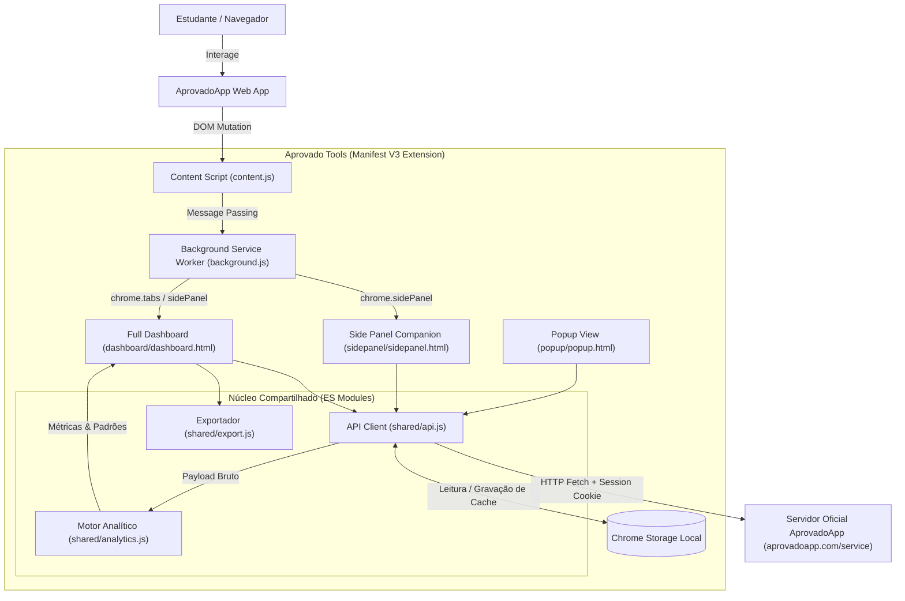
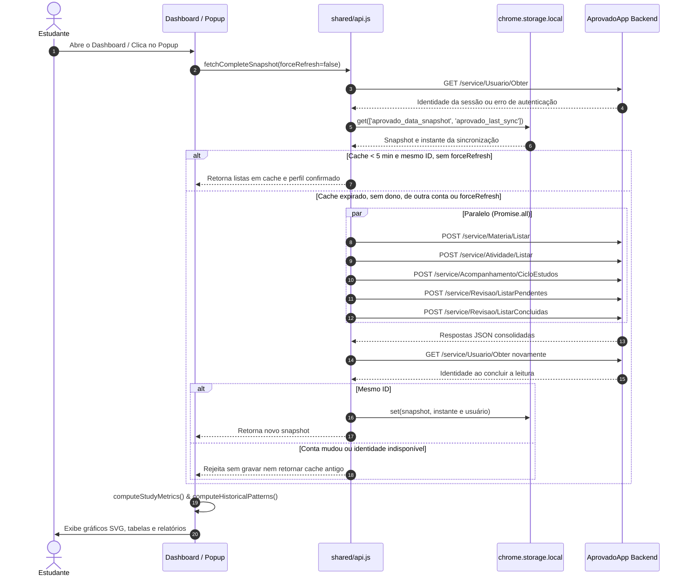
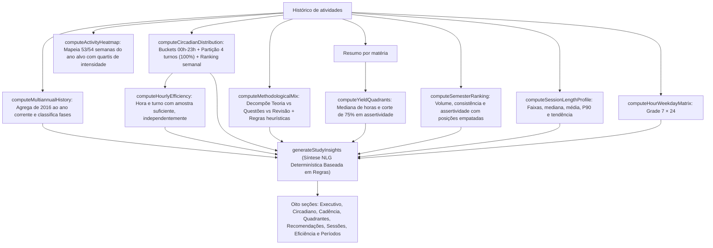

# Arquitetura do Sistema — Aprovado Tools

Este documento detalha o desenho arquitetural, as interações entre subsistemas, os fluxos de dados, as decisões de design e as restrições da extensão **Aprovado Tools** (Manifest V3).

---

## 1. Visão Geral de Alto Nível

O **Aprovado Tools** é uma solução de auditoria analítica e exportação que opera **100% no lado do cliente** (*client-side only*). Ela se acopla ao ecossistema do AprovadoApp através de injeção pontual de interface (DOM) e consumo dos endpoints usados pelo serviço web, dispensando servidores intermediários, bancos de dados em nuvem ou processamento por modelos externos de Inteligência Artificial.

---

## 2. Interações entre Componentes

### 2.1. Content Script (`content.js`)
- **Papel:** Injeção não invasiva de botões na barra de navegação superior (`.navbar-nav`) e, apenas quando o site não tem essa barra, um único botão flutuante de acesso rápido.
- **Comunicação:** Não manipula dados analíticos diretamente. Dispara mensagens `OPEN_DASHBOARD` via `chrome.runtime.sendMessage` para delegar ações ao Service Worker.

### 2.2. Service Worker (`background.js`)
- **Papel:** Ponto de entrada do ciclo de vida da extensão no Manifest V3.
- **Comportamento Efêmero:** Não mantém variáveis em memória entre chamadas. Escuta cliques em menus de contexto (`chrome.contextMenus`), gerencia a abertura do `chrome.sidePanel` por janela e abre o dashboard em aba dedicada (`chrome.tabs.create`).

### 2.3. Vistas de Usuário (Popup, SidePanel e Dashboard)
- **Popup (`popup/`):** Visão compacta (340px) exibindo tempo total, sessões, assertividade, progresso do ciclo e botões de exportação rápida.
- **Side Panel (`sidepanel/`):** Painel lateral retrátil que acompanha a navegação do usuário em abas de estudo e leitura, exibindo revisões pendentes e distribuição de matérias.
- **Dashboard (`dashboard/`):** Aplicação de página inteira com três seções em abas, cada uma com endereço próprio por hash (`#visao-geral`, `#historico`, `#atividades`) e navegação pelo histórico do navegador:
  1. *Visão geral:* Indicadores, evolução por dia, semana ou mês conforme o período (`buildTimelineSeries`), ciclo, tabela de matérias, modalidades agrupadas (`groupByModality`) e turnos.
  2. *Histórico:* Usa todos os registros. Os filtros de período, matéria e modalidade ficam visíveis e desabilitados. Inclui ranking de semestres/anos, grade dia × hora, eficiência por hora/turno, perfil de duração das sessões, mapa anual de atividade, análise multianual, matriz de rendimento e mix metodológico. Os indicadores multianuais usam 2016 até o ano corrente; o ranking inclui todos os anos presentes no histórico.
  3. *Atividades:* Tabela de sessões, da mais recente para a mais antiga, com busca e paginação, sob os filtros de período, matéria e modalidade.
  Com `?mock=true` (ou fora da extensão), uma faixa informa que os dados são de exemplo e a identificação da conta fica oculta.

### 2.4. Núcleo de Domínio (`shared/`)
- **`api.js`:** Encapsula requisições autenticadas para os endpoints `/service/*` do AprovadoApp. O cache local de 5 minutos só é reutilizado após consultar a identidade da sessão e comparar seu ID com `snapshot.user.Id`. Sem identidade confirmada não há fallback para dados anteriores. Durante uma sincronização completa, verifica novamente a conta antes de gravar, rejeitando uma troca detectada durante o carregamento. Falhas preservam o cache anterior, mas não o retornam como resultado dessa tentativa.
- **`analytics.js`:** Biblioteca pura e determinística com zero dependências. Converte logs brutos em modelos analíticos ricos (histogramas, quartis, medianas e textos NLG).
- **`format.js`:** Formatação de exibição em pt-BR (`1.234,5`, `74,3%`, `4.460,1h`). Exportações CSV e JSON mantêm formatos estáveis para máquina; o Markdown reaproveita alguns textos de exibição, como as horas totais.
- **`export.js`:** Utilitário para geração de arquivos para download (CSV compatível com Excel via UTF-8 BOM, backup estruturado em JSON e relatórios em Markdown para Notion/Obsidian).

---

## 3. Diagramas de Fluxo de Dados

### 3.1. Fluxo de Sincronização e Carga de Métricas

### 3.2. Fluxo de Geração de Análise Histórica e Síntese Determinística (NLG)

---

## 4. Decisões de Design e Justificativa

| Decisão de Design | Alternativa Rejeitada | Justificativa Técnica |
|---|---|---|
| **Abordagem 100% Determinística (Zero-AI)** | Uso de APIs externas como OpenAI GPT-4 ou Google Gemini | **Privacidade e custo:** Toda a síntese analítica é gerada por algoritmos de regras no próprio navegador do usuário, com nenhum serviço de IA contratado. Os cálculos dispensam rede depois de receber o snapshot; a carga normal, inclusive de cache, exige confirmação online da identidade. A prévia sintética é o modo separado de desenvolvimento sem conta. |
| **Manifest V3 Estrito** | Manifest V2 legado | MV3 é a especificação obrigatória da Chrome Web Store. Garante segurança por meio de CSP restrito (proibição de `eval` e scripts remotos) e menor consumo de bateria via Service Workers orientados a eventos. |
| **Gráficos em SVG Puro Sem Bibliotecas** | Dependências como Chart.js, Recharts ou D3.js | As bibliotecas tradicionais pesam centenas de kilobytes e violam princípios de bundle leve. Gerar `<svg>` nativo diretamente com código procedural consome 0 KB de dependências externas, dispensa o carregamento de bibliotecas de gráficos e permite estilização CSS total com variáveis nativas. |
| **Autenticação por Cookies Nativos** | Armazenamento de usuário e senha na extensão | A extensão utiliza o cookie de sessão `aprovado` já emitido pelo site oficial com `credentials: 'include'`. Isso elimina a necessidade de coletar credenciais sensíveis e dispensa o armazenamento de senhas na extensão. |
| **Exportação CSV com UTF-8 BOM (`\uFEFF`)** | CSV padrão sem BOM | Softwares como o Microsoft Excel assumem codificações legadas (como Windows-1252) ao abrir CSVs no Brasil. A adição explícita do BOM UTF-8 garante acentuação correta em português sem exigir configurações manuais do usuário. |

---

## 5. Restrições e Limitações do Sistema

1. **Dependência de Sessão Web Ativa**:
   - A extensão não armazena login e senha do usuário. Caso o cookie de autenticação do AprovadoApp expire, o usuário deve acessar o site oficial para renovar a sessão.
2. **CORS e Políticas de Cookies do Navegador**:
   - As telas fazem `fetch` com `credentials: include` para `https://aprovadoapp.com/service`. O manifesto permite HTTPS nas raízes `.com`, `.com.br` e seus subdomínios, também usados pelos atalhos. A autenticação usa a sessão enviada pelo navegador, sem acesso à API de leitura de cookies. As permissões `cookies` e `tabs` e o handler sem consumidores `CHECK_LOGIN_STATUS` foram removidos; criar abas e obter o `windowId` da aba ativa dispensam acesso aos campos sensíveis de histórico.
3. **Ausência de Webhooks ou Eventos Push no AprovadoApp**:
   - A extensão consulta a identidade antes de reutilizar listas em cache por até 5 minutos. O botão Sincronizar força a atualização das listas. Isso exige acesso ao serviço mesmo quando as listas ainda estão em cache; não há leitura offline de cache sem autenticação confirmada.
4. **Volume de Histórico e Capacidade de Armazenamento**:
   - Usuários com mais de uma década de estudo acumulam megabytes de registros JSON. Para evitar a cota padrão de `chrome.storage.local` (10 MB no Chrome atual; 5 MB até o Chrome 113), o manifesto inclui obrigatoriamente a permissão `"unlimitedStorage"`.

5. **Retenção e estado já carregado**:
   - O prazo de cache não é um prazo de exclusão. Logout não apaga automaticamente `chrome.storage.local` nem revoga snapshots já em memória; uma falha de carga ou sincronização limpa os snapshots em memória e os dados renderizados nas três telas, bloqueando exportações até a recuperação. Não há observador contínuo de logout. Os controles de identidade protegem novas leituras e gravações. Veja [PRIVACY.md](PRIVACY.md).
6. **Conversão experimental de backup**:
   - `shared/backup.js` é um conversor puro, testado e sem integração às telas; é excluído do ZIP. Propostas em `plans/` não representam uma funcionalidade disponível.

Referências: [armazenamento do Chrome](https://developer.chrome.com/docs/extensions/reference/api/storage) e [permissão de cookies](https://developer.chrome.com/docs/extensions/reference/api/cookies).
