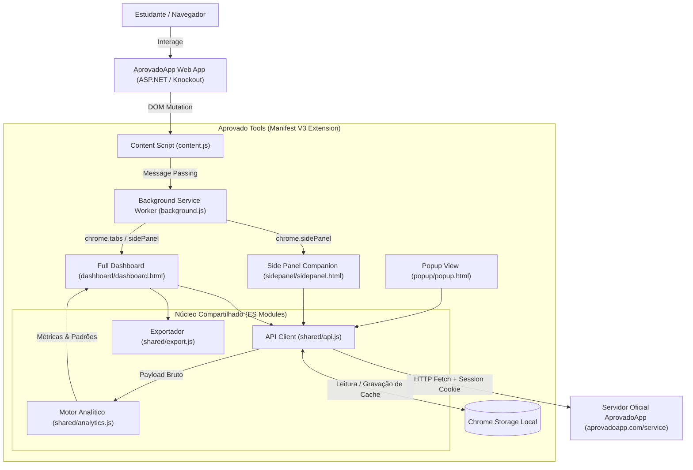
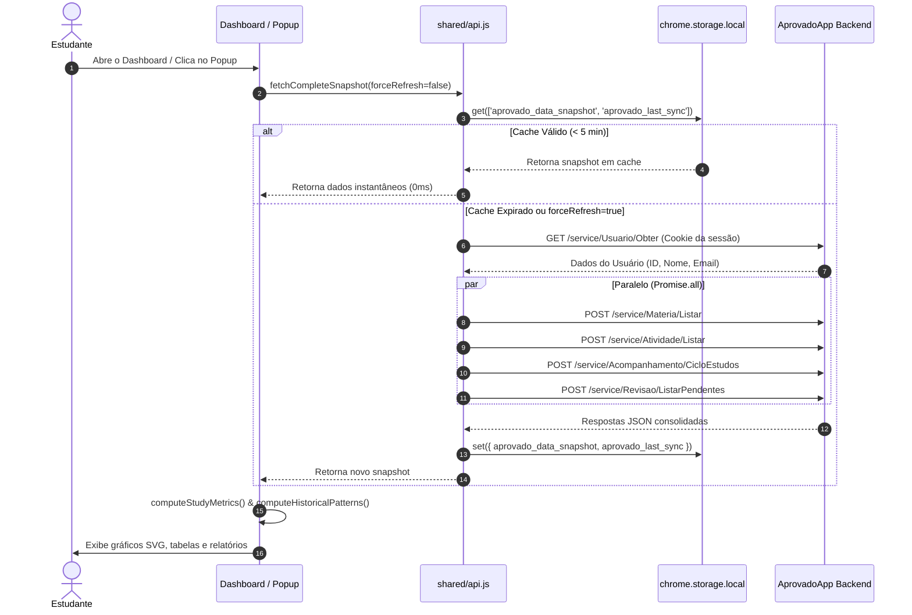
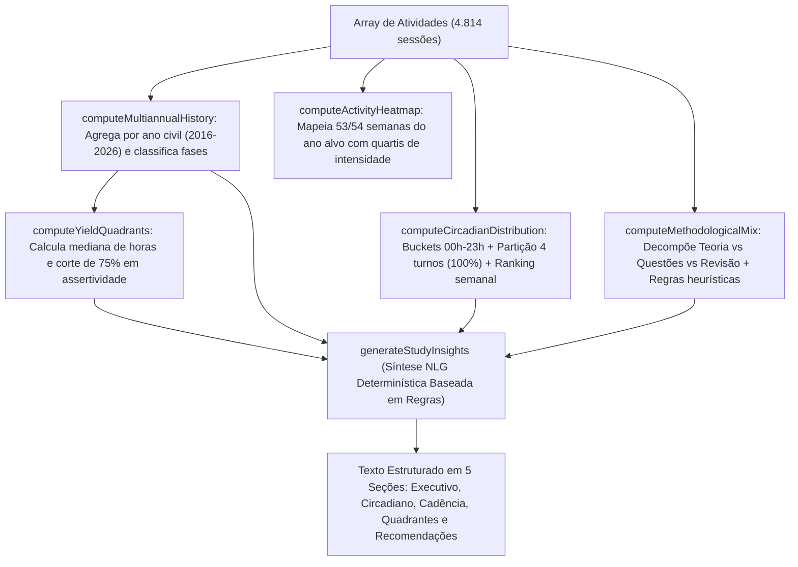

# Arquitetura do Sistema — Aprovado Tools

Este documento detalha o desenho arquitetural, as interações entre subsistemas, os fluxos de dados, as decisões de design e as restrições da extensão **Aprovado Tools** (Manifest V3).

---

## 1. Visão Geral de Alto Nível

O **Aprovado Tools** é uma solução de auditoria analítica e exportação que opera **100% no lado do cliente** (*client-side only*). Ela se acopla ao ecossistema do AprovadoApp através de injeção pontual de interface (DOM) e consumo da API oficial reversa, dispensando servidores intermediários, bancos de dados em nuvem ou processamento por modelos externos de Inteligência Artificial.

---

## 2. Interações entre Componentes

### 2.1. Content Script (`content.js`)
- **Papel:** Injeção não invasiva de botões na barra de navegação superior (`.navbar-nav`) e badge flutuante de acesso rápido.
- **Comunicação:** Não manipula dados analíticos diretamente. Dispara mensagens `OPEN_DASHBOARD` via `chrome.runtime.sendMessage` para delegar ações ao Service Worker.

### 2.2. Service Worker (`background.js`)
- **Papel:** Ponto de entrada do ciclo de vida da extensão no Manifest V3.
- **Comportamento Efêmero:** Não mantém variáveis em memória entre chamadas. Escuta cliques em menus de contexto (`chrome.contextMenus`), gerencia a abertura do `chrome.sidePanel` por janela e abre o dashboard em aba dedicada (`chrome.tabs.create`).

### 2.3. Vistas de Usuário (Popup, SidePanel e Dashboard)
- **Popup (`popup/`):** Visão ultrarrápida (340px) exibindo tempo total, sessões, assertividade, progresso do ciclo e botões de exportação rápida.
- **Side Panel (`sidepanel/`):** Painel lateral retrátil que acompanha a navegação do usuário em abas de estudo e leitura, exibindo revisões pendentes e distribuição de matérias.
- **Dashboard (`dashboard/`):** Aplicação de página inteira dividida em duas abas principais:
  1. *Visão Geral:* Filtros de data, busca com paginação, linha do tempo diária e tabela de matérias.
  2. *Padrões Históricos de Estudo (2016 até o ano corrente):* Análise multianual, mapa anual de atividade (heatmap estilo GitHub), distribuição circadiana 24h com produtividade por turno, matriz 2x2 de rendimento e mix metodológico.

### 2.4. Núcleo de Domínio (`shared/`)
- **`api.js`:** Encapsula requisições autenticadas para os endpoints `/service/*` do AprovadoApp (`Atividade/Listar`, `Materia/Listar`, `Acompanhamento/CicloEstudos`, `Revisao/ListarPendentes`). Gerencia cache local de 5 minutos com `chrome.storage.local`.
- **`analytics.js`:** Biblioteca pura e determinística com zero dependências. Converte logs brutos em modelos analíticos ricos (histogramas, quartis, medianas e textos NLG).
- **`export.js`:** Utilitário para geração de arquivos para download (CSV compatível com Excel via UTF-8 BOM, backup estruturado em JSON e relatórios em Markdown para Notion/Obsidian).

---

## 3. Diagramas de Fluxo de Dados

### 3.1. Fluxo de Sincronização e Carga de Métricas

### 3.2. Fluxo de Geração de Análise Histórica e Síntese Determinística (NLG)

---

## 4. Decisões de Design e Justificativa

| Decisão de Design | Alternativa Rejeitada | Justificativa Técnica |
|---|---|---|
| **Abordagem 100% Determinística (Zero-AI)** | Uso de APIs externas como OpenAI GPT-4 ou Google Gemini | **Privacidade e custo:** Toda a síntese analítica é gerada por algoritmos de regras no próprio navegador do usuário, com **zero custo de infraestrutura**, latência sub-milissegundo, funcionamento 100% offline e sem risco de vazamento de dados de estudo do estudante para servidores de IA. |
| **Manifest V3 Estrito** | Manifest V2 legado | MV3 é a especificação obrigatória da Chrome Web Store. Garante segurança por meio de CSP restrito (proibição de `eval` e scripts remotos) e menor consumo de bateria via Service Workers orientados a eventos. |
| **Gráficos em SVG Puro Sem Bibliotecas** | Dependências como Chart.js, Recharts ou D3.js | As bibliotecas tradicionais pesam centenas de kilobytes e violam princípios de bundle leve. Gerar `<svg>` nativo diretamente com código procedural consome 0 KB de dependências externas, renderiza instantaneamente e permite estilização CSS total com variáveis nativas. |
| **Autenticação por Cookies Nativos** | Armazenamento de usuário e senha na extensão | A extensão utiliza o cookie de sessão `aprovado` já emitido pelo site oficial com `credentials: 'include'`. Isso elimina a necessidade de coletar credenciais sensíveis e evita qualquer risco de armazenamento de senhas. |
| **Exportação CSV com UTF-8 BOM (`\uFEFF`)** | CSV padrão sem BOM | Softwares como o Microsoft Excel assumem codificações legadas (como Windows-1252) ao abrir CSVs no Brasil. A adição explícita do BOM UTF-8 garante acentuação correta em português sem exigir configurações manuais do usuário. |

---

## 5. Restrições e Limitações do Sistema

1. **Dependência de Sessão Web Ativa**:
   - A extensão não armazena login e senha do usuário. Caso o cookie de autenticação do AprovadoApp expire, o usuário deve acessar o site oficial para renovar a sessão.
2. **CORS e Políticas de Cookies do Navegador**:
   - Para que as requisições com cookies funcionem em background, a extensão exige explicitamente `host_permissions` para `*://*.aprovadoapp.com/*` e `*://*.aprovadoapp.com.br/*` e a permissão `"cookies"`.
3. **Ausência de Webhooks ou Eventos Push no AprovadoApp**:
   - A API do AprovadoApp não emite notificações quando uma nova atividade é finalizada no aplicativo móvel. Por isso, adota-se uma estratégia de cache de 5 minutos com revalidação explícita via botão de sincronização.
4. **Volume de Histórico e Capacidade de Armazenamento**:
   - Usuários com mais de uma década de estudo acumulam megabytes de registros JSON. Para evitar a limitação da cota de 5 MB do `chrome.storage.local`, o manifesto inclui obrigatoriamente a permissão `"unlimitedStorage"`.
