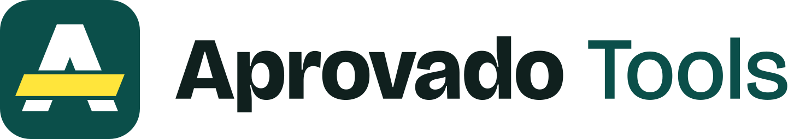
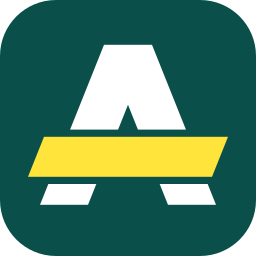
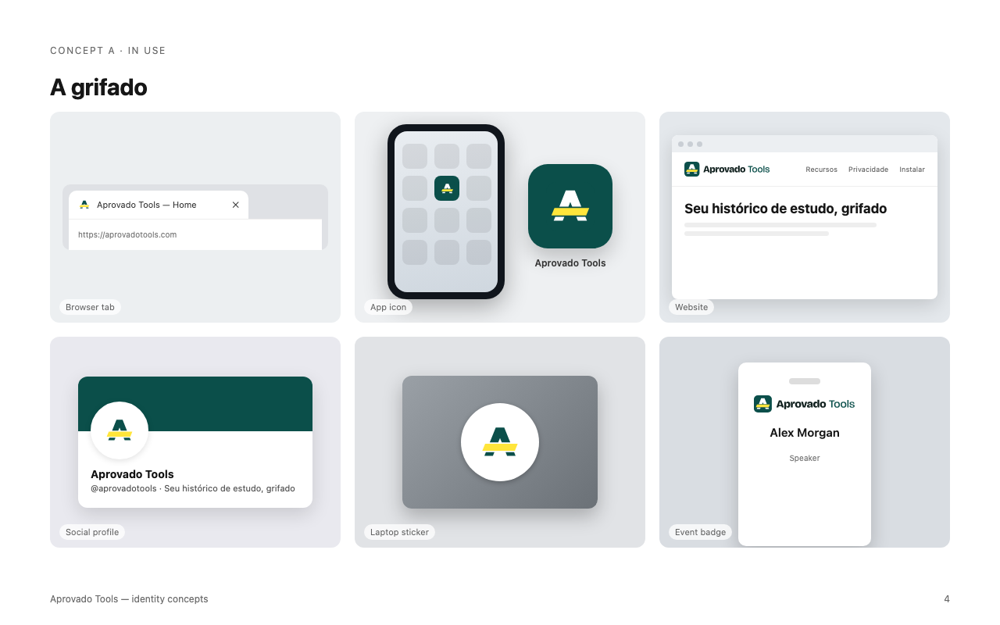

# Guia da marca

Versão 1, de 3 de novembro de 2026. Status: direção escolhida e aplicada aos
ícones da extensão (`icons/`) e aos cabeçalhos do popup, do painel lateral e do
dashboard. As capturas da Chrome Web Store ainda mostram o ícone anterior.

A barra do A é uma passada de marca-texto, como quem grifa a lei seca. O
símbolo junta o nome ao gesto mais típico de quem estuda para concurso, sem
prometer aprovação e sem lembrar o logo oficial do AprovadoApp.

Para ver o guia visual completo, com construção, simulação da barra do navegador
e exemplos de uso, abra [guia.html](guia.html) no navegador a partir de um
checkout local. O GitHub mostra esse arquivo como código-fonte.

## Construção

O símbolo é desenhado numa grade de 16 unidades. Em 16 px, cada unidade
corresponde a um pixel da barra do Chrome.

| Elemento | Regra |
|---|---|
| Letra | A de topo reto, pernas com 3 unidades de largura e inclinação de 0,4 (2 para 5). Não tem barra própria: quem faz a barra é o grifo. |
| Grifo | Paralelogramo de 2,5 unidades de altura que vaza das pernas. As pontas são paralelas à perna esquerda, como a ponta chanfrada do marca-texto. |
| Respiro | 0,45 unidade entre o grifo e a letra. Ele mantém a ideia nas versões de uma cor. |
| Ajuste óptico | O conjunto sobe 0,2 unidade, porque o peso do grifo fica abaixo do centro. |
| Corte pequeno | De 16 a 48 px: grifo de 2 unidades, sem respiro e com bordas horizontais em pixel inteiro. |

## Cores

| Nome | Uso | HEX | RGB | Contraste |
|---|---|---|---|---|
| Petróleo | Cor principal: contêiner e letra | `#0B4F4A` | 11 79 74 | Branco sobre ela: 9,4:1 |
| Marca-texto | Só no grifo | `#FFE53B` | 255 229 59 | Sobre petróleo: 7,4:1; sobre branco: 1,3:1 |
| Tinta | Nome sobre fundo claro | `#10201E` | 16 32 30 | Sobre branco: 16,8:1 |
| Noite | Fundo escuro | `#0E1312` | 14 19 18 | Amarelo sobre ela: 14,8:1 |

O azul domina a categoria de educação (43% das marcas de educação na biblioteca
de referência da skill de logo). Petróleo e amarelo saem desse território.

## Tipografia

Bricolage Grotesque, com licença SIL Open Font License, que permite uso em logo.
“Aprovado” em ExtraBold (800) e “Tools” em Medium (500). Nos arquivos finais, o
nome está convertido em curvas e não depende da fonte instalada.

## Assinaturas e variações

A altura da maiúscula é 0,42 da altura do símbolo, e o respiro até o nome é 0,25
dela. Use a horizontal em cabeçalhos e na ficha da loja e a empilhada em espaços
quadrados.

| Arquivo | Uso |
|---|---|
| [aprovado-tools-icone.svg](svg/aprovado-tools-icone.svg) | Ícone padrão, com contêiner |
| [aprovado-tools-icone-pequeno.svg](svg/aprovado-tools-icone-pequeno.svg) | Corte para 16 a 48 px |
| [aprovado-tools-icone-loja.svg](svg/aprovado-tools-icone-loja.svg) | Ficha da loja: arte de 96 px dentro de 128 px |
| [aprovado-tools-simbolo.svg](svg/aprovado-tools-simbolo.svg) | Sem contêiner, fundo claro, 24 px ou mais |
| [aprovado-tools-simbolo-pequeno.svg](svg/aprovado-tools-simbolo-pequeno.svg) | Símbolo sem contêiner em tamanho pequeno |
| [aprovado-tools-assinatura-horizontal.svg](svg/aprovado-tools-assinatura-horizontal.svg) | Assinatura sobre fundo claro |
| [aprovado-tools-assinatura-horizontal-escura.svg](svg/aprovado-tools-assinatura-horizontal-escura.svg) | Assinatura sobre fundo escuro |
| [aprovado-tools-assinatura-empilhada.svg](svg/aprovado-tools-assinatura-empilhada.svg) | Espaços quadrados |
| [variantes/](svg/variantes/) | Uma cor: preto, branco e petróleo |
| [png/icon-16.png](png/icon-16.png) · [32](png/icon-32.png) · [48](png/icon-48.png) · [128](png/icon-128.png) | Ícones da extensão gerados a partir do corte pequeno |

## Regras de uso

- **Área de proteção:** a altura do grifo (2,5 unidades) em volta do símbolo ou
  da assinatura.
- **Tamanho mínimo:** 16 px com contêiner, 24 px sem contêiner e 120 px de
  largura para a assinatura horizontal.
- **Sobre petróleo:** use a versão branca, ou o ícone com contêiner, que já leva
  o grifo amarelo.
- **Sobre fundo claro:** use as cores originais. O grifo fica atrás da letra.
- **Não use** a letra petróleo sobre petróleo: o A desaparece.
- **Não use** as cores originais sobre preto: o petróleo some (2:1). Use a
  versão branca.
- **Não distorça** nem estique: a inclinação comum entre a perna e o grifo se
  perde.
- **Não troque as cores:** em outra cor, o grifo deixa de ser marca-texto.

## Aplicações

Aplicações ilustrativas geradas pela skill de logo. O endereço e o perfil
mostrados são exemplos, não contas reais.

## Origem e próximos passos

A direção foi escolhida em 3 de novembro de 2026, depois de duas rodadas de
conceitos. O processo está registrado em [Direção da logo](../direcao-logo.md).
Os desenhos foram feitos com a skill
[logo-design](https://github.com/kaankiziltug/logo-design-skill) e revisados
em 16, 32, 48 e 128 px, em uma cor e invertidos.

O Aprovado Tools é um projeto pessoal e sem fins comerciais, então não há
pesquisa de marca registrada prevista.

1. **Aplicação na extensão:** feita. `icons/` usa os PNGs de `png/` e o
   `scripts/generate_icons.py` foi removido. Veja o
   [recibo](../validacao-icones-a-grifado.md).
2. **Capturas da Chrome Web Store:** refeitas com a nova identidade em
   `store-assets/`.
